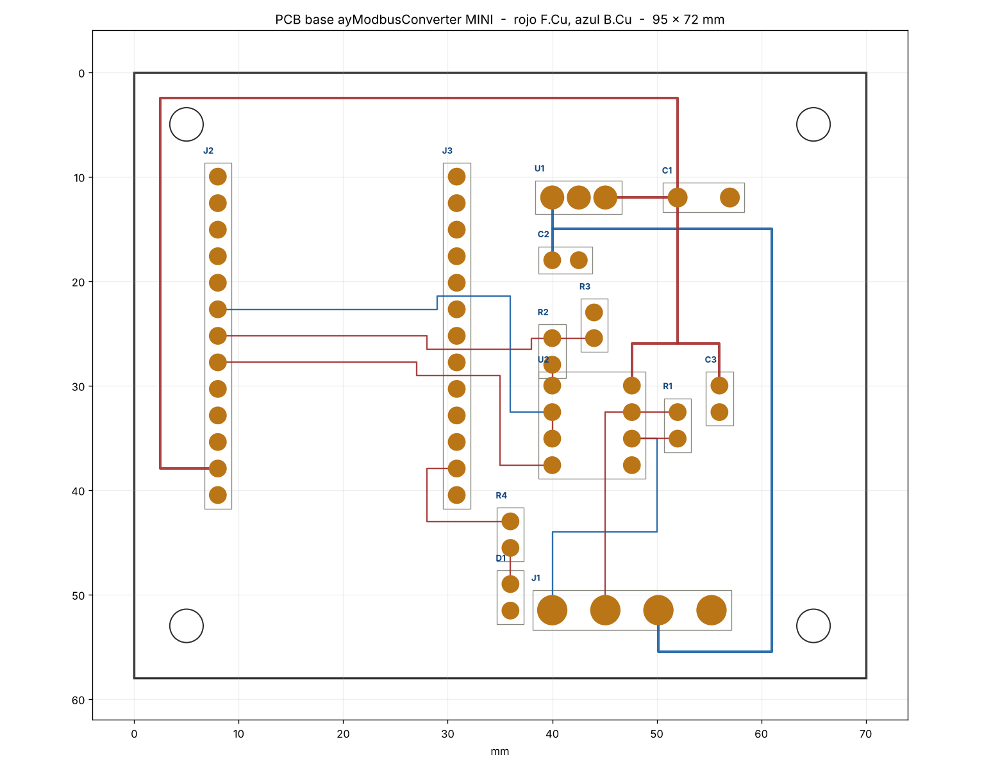

# PCB base — ayModbusConverter MINI

Rev E · KiCad 8 · **70 × 58 mm**, dos capas

Placa reducida al mínimo práctico, atornillada al chasis, que a su vez va al riel DIN por los anclajes. La
WT32-ETH01 se enchufa en dos zócalos de 13 pines con el **eje largo vertical**: el RJ45
sale por la pared superior del chasis y la bornera por la inferior. La tapa solo lleva el
agujero del LED de enlace.

---

## 1. Qué lleva

| Ref | Valor | Función |
|---|---|---|
| J1 | Bornera 4 vías, paso 5,08 | A, B, +V (9–24 VDC), GND |
| J2, J3 | Zócalo hembra 1×13, paso 2,54 | WT32-ETH01, filas a **22,86 mm** |
| U1 | 7805 TO-220 | +V → 5 V |
| U2 | MAX485 DIP-8 | Transceptor RS-485 half duplex |
| C1 | 100 µF / 25 V | Salida del regulador |
| C2 | 0,33 µF | Entrada del regulador |
| C3 | 100 nF | Desacoplo del MAX485 |
| R1 | 120 Ω | Terminación entre A y B |
| R2, R3 | 1 k / 2 k | Divisor de RO, 5 V → 3,3 V |
| R4 | 1 k | Limitador del LED |
| D1 | LED 3 mm | Enlace Modbus |

La bornera admite AWG18 sin problema: taladro de 1,3 mm y pad de 2,8 mm.

---

## 2. Tres cosas que cambié respecto a lo pedido

### 2.1 Separación de los zócalos: 22,86 mm, no 24

La cota real del módulo son **22,86 mm** (0,9 pulgadas), verificada contra la huella del
datasheet V1.4. Con 24 mm el módulo sencillamente no entra: son 1,14 mm de desalineación
repartidos en 13 pines. Además 24 / 2,54 = 9,45, o sea que 24 mm ni siquiera cae en la
rejilla de 2,54 en la que están los pines.

Es el único punto donde no seguí la indicación al pie de la letra, y lo hice porque la
alternativa era una placa inservible.

### 2.2 Divisor R2 / R3 en RO

No estaba en tu lista, pero es obligatorio. El MAX485 alimentado a 5 V saca **RO a 5 V**,
y esa señal entra en IO5 del ESP32, que es de 3,3 V. Sin divisor se destruye la entrada.
R2 de 1 k y R3 de 2 k la dejan en 3,33 V.

Si prefieres quitar los dos resistores, cambia el MAX485 por un **MAX3485 o SP3485**
(mismo pinout DIP-8) alimentado a 3,3 V desde el propio módulo. Son dos componentes menos
y una fuente de error menos.

### 2.3 Condensador de salida: 25 V, no 6 V

Pediste 100 µF / 6 V sobre un bus de 5 V. Eso es 1,2× de margen, cuando lo habitual es
1,5× a 2×. Los electrolíticos pierden capacidad con la temperatura y la edad, y dentro de
un tablero cerrado envejecen rápido. Puse 25 V, que no cuesta más ni ocupa mucho más.

---

## 3. El 7805 es el punto débil de esta placa

Lo monté como pediste, pero conviene saber lo que implica:

| Entrada | 150 mA | 250 mA | 350 mA |
|---|---|---|---|
| 9 V | 0,60 W | 1,00 W | 1,40 W |
| 12 V | 1,05 W | 1,75 W | 2,45 W |
| 24 V | 2,85 W | **4,75 W** | **6,65 W** |

El consumo del WT32-ETH01 con Ethernet activo y picos de WiFi está entre 150 y 350 mA.

A 24 V de entrada el regulador tiene que disipar entre 3 y 7 W. Un TO-220 sin disipador
aguanta algo más de 1 W antes de superar los 100 °C de encapsulado. Con 7 W dentro de una
caja de inoxidable cerrada, el 7805 entra en protección térmica y el equipo se reinicia en
bucle.

Tres salidas, de menos a más trabajo:

1. **Alimentar a 9 V.** Dentro del rango que pediste y la disipación baja a 1 W. Con un
   disipador pequeño funciona.
2. **Sustituir por un K7805-2000R3.** Es un convertidor conmutado con el **mismo pinout
   SIP-3** que el 7805, así que entra en la misma huella sin tocar la placa. Rendimiento
   del 90 %, disipa menos de 0,2 W a 24 V. Cuesta unas pocas veces más que un 7805 y
   resuelve el problema entero.
3. **Dejar el 7805 con disipador** y limitar la entrada a 12 V.

La huella que puse admite las tres: los tres pines son IN, GND, OUT a paso 2,54.

---

## 4. El LED de enlace

D1 está en la posición (66, 52) de la placa, que en la caja queda a **Y = −17,3 mm,
Z = +18,5 mm** respecto al centro de la tapa.

Lo mueve IO2, que en el firmware es `PIN_LED_ACT`: parpadea con cada trama Modbus válida.
Entre paquetes queda apagado, así que un parpadeo continuo significa que hay polling en
ambos extremos, que es justo lo que querías ver.

**Necesita guía de luz.** Desde la cara superior del PCB hasta la cara interior de la tapa
hay 32,4 mm. Un LED de 3 mm soldado a ras no llega ni de lejos. Dos opciones: una guía de
luz de 3 mm de ese largo, o montar el LED sobre patillas largas de modo que la cápsula
quede a ras de la tapa. La segunda es más frágil pero no cuesta nada.

---

## 5. Ruteado

Dos capas, con plano de masa en ambas. No hay vías de señal: todos los componentes son de
agujero pasante, así que cada pad une las dos capas por sí mismo.

| Capa | Nets |
|---|---|
| F.Cu | +5V, RS485_B, P1_RO, P1_DI, RO_RAW, LED_D, LED_A |
| B.Cu | +VIN, RS485_A, P1_DE |

Tres nets van por la cara inferior porque sus cruces son topológicamente inevitables: A y B
se cruzan entre el MAX485 y la bornera, y DE cruza a RO y DI porque el orden de los pines
del MAX485 es el inverso del orden de los pines del módulo.

Anchos: 1,0 mm en alimentación, 0,5 mm en señal.

### Verificación automática

El generador comprueba, antes de escribir el archivo:

- pads que se solapan
- pistas que pasan sobre pads de otra red
- cruces entre pistas de distinta red en la misma capa
- pads con red pero sin pista que los toque
- componentes fuera del contorno

Las cinco pasan. Cuatro de ellas fallaron en la primera pasada y señalaron errores reales:
la pista de +5 V pasaba por encima del pad de masa del propio C1, y la del LED bajaba justo
por la columna de pads de la fila B y pisaba el pin 14.

---

## 6. Conexiones al módulo

| Pin del módulo | Señal | Va a |
|---|---|---|
| 7 (IO5) | RO | Divisor R2/R3 |
| 8 (IO17) | DI | U2 pin 4 |
| 6 (IO33) | DE + RE̅ | U2 pines 2 y 3 |
| 12 | 5 V | Salida del 7805 |
| 15 (IO2) | LED | R4 → D1 |
| 2, 9, 11, 14, 23 | GND | Plano |

Coinciden con `src/board.h` del firmware. Los demás pines quedan sin conectar.

---

## 7. Lo que esta placa no lleva

Por simplificar quedaron fuera tres cosas que conviene tener presentes:

- **Sin cabecera de programación.** La primera grabación hay que hacerla con el módulo
  fuera de la placa, con un adaptador USB-TTL. Después todo va por OTA.
- **Sin botón CFG.** El firmware usa IO32 para levantar el AP de WiFi y para los valores de
  fábrica. Sin botón, la configuración es solo por Ethernet o por la consola serie del
  módulo desenchufado.
- **Sin protección de entrada.** No hay fusible, ni diodo antiinversión, ni TVS en el bus.
  Si el equipo va a un tablero industrial con maniobra inductiva cerca, merece la pena
  añadir al menos una SM712 entre A, B y GND.

Ninguna impide que funcione; las tres son decisiones conscientes.

---

## 8. Archivos

| Archivo | Contenido |
|---|---|
| `aymc_carrier_min.kicad_pcb` | Placa ruteada |
| `aymc_carrier_min.kicad_sch` | Esquema |
| `aymc.kicad_sym` | Símbolos |
| `pcb_preview.png` | Vista del trazado |
| `netlist.csv` | 11 redes |
| `bom.csv` | Lista de materiales |
| `tools/gen_pcb.py` | Genera placa, netlist y BOM, y verifica el ruteado |
| `tools/gen_sch.py` | Genera el esquema desde la misma tabla |

Esquema y placa salen de **una sola tabla de componentes y redes**, así que no pueden
desincronizarse. Si cambias algo, cámbialo en `gen_pcb.py` y vuelve a ejecutar los dos.

---

## 9. Reducción respecto a la Rev D

| Concepto | Rev D | Rev E | Reducción |
|---|---|---|---|
| Placa | 95 × 72 mm | **70 × 58 mm** | 41 % de área |
| Interior de la caja | 104 × 82 × 40 | **78 × 68 × 36** | 44 % de volumen |
| Chapa bruta | 366 cm² | **249 cm²** | 32 % |
| Masa de inoxidable | 289 g | **197 g** | 32 % |

Qué permitió apretarla:

- El MAX485, el divisor y la terminación se agruparon en la columna derecha junto a la
  bornera, en vez de repartirse por la placa.
- Los taladros de fijación pasaron a 5 mm del borde y la alimentación cruza por el borde
  superior, a 2,5 mm, que es donde no estorba a nada.
- El ancho de pista en señal bajó a 0,25 mm, lo justo para pasar entre pads a paso 2,54
  con 0,2 mm de holgura. La alimentación se mantiene en 0,8 mm.

El límite ahora lo pone el propio módulo: 60 mm de largo con el RJ45 asomando, más la
bornera debajo sin solaparse con él. Para bajar de 58 mm de alto habría que mover la
bornera a un costado, y entonces saldría por la tapa en vez de por el chasis.
