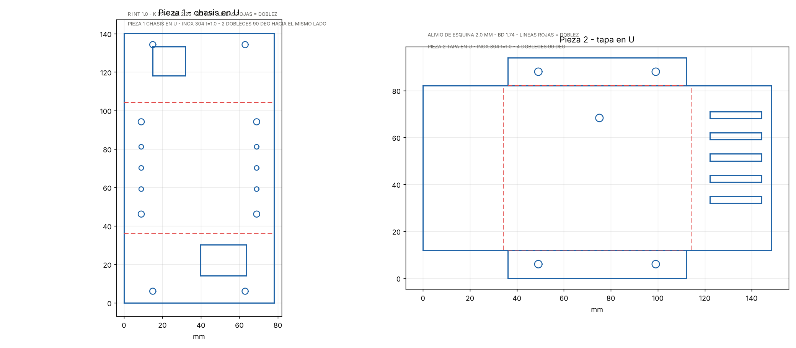

# Carcasa de chapa inoxidable — ayModbusConverter MINI

Dos piezas de acero inoxidable AISI 304 de 1,0 mm, todos los dobleces a 90°, más dos
bases de riel DIN impresas en 3D.

---

## 1. Concepto

| Pieza | Material | Dobleces | Desarrollo |
|---|---|:-:|---|
| 1 · Chasis en U | Inox 304, 1,0 mm | 2 | 78,0 × 140,3 mm |
| 2 · Tapa en U | Inox 304, 1,0 mm | 4 | 148,3 × 94,0 mm |
| 3 · Clip DIN ×2 | PETG o ABS | — | impreso |

Chapa bruta: **249 cm² por equipo**, unos **197 g** de inoxidable.

**Todas las aberturas van en el chasis.** La pared inferior lleva la ventana de la bornera
de 4 vías y la superior la del RJ45 del módulo, que sale por ahí porque el módulo va con
el eje largo vertical. El PCB se atornilla al fondo sobre cuatro separadores de 6 mm.

La **tapa** envuelve el frente y los dos laterales y solo tiene **un agujero de 3,2 mm para
el LED de enlace**, más la rejilla de ventilación del costado derecho. Se fija con cuatro
tornillos M3 a través de dos pestañas.

Las borneras quedan **retenidas por la chapa**: el cuerpo del conector asoma por la
ventana y la pared de 1 mm absorbe el esfuerzo del cable, en lugar de transmitirlo a las
soldaduras del PCB. Es la razón de que las ventanas sean ajustadas.

---

## 2. Cotas

| Concepto | Valor |
|---|---|
| Interior | 78 × 68 × 36 mm |
| Espesor | 1,0 mm |
| Radio interior de doblado | 1,0 mm |
| Factor K | 0,44 (inox recocido) |
| Bend allowance 90° | 2,262 mm |
| Deducción de doblado | 1,738 mm |
| Alivio de esquina | 2,0 mm |

Altura ocupada dentro de la caja: 6 mm de separador + 1,6 de PCB + 8,5 de zócalo + 17 del
módulo = **33,1 mm** de los 36 disponibles. Quedan 2,9 mm de holgura.

> El factor K de 0,44 es el valor habitual del inoxidable recocido con radio igual al
> espesor. Si tu taller trabaja con otro, cámbialo en `gen_carcasa.py` y vuelve a generar
> los DXF: el desarrollo cambia unas décimas por doblez.

---

## 3. Archivos

| Archivo | Para qué sirve |
|---|---|
| `pieza1_chasis_desarrollo.dxf` | Corte láser y plegado del chasis |
| `pieza2_tapa_desarrollo.dxf` | Corte láser y plegado de la tapa |
| `desarrollos.png` | Vista rápida de ambos desarrollos |
| `fusion_carcasa.py` | Script de Fusion 360 que construye el 3D |
| `clip_din35.scad` | Clip de riel DIN paramétrico en OpenSCAD |
| `../../gen_carcasa.py` | Generador de los DXF (Python puro) |

### Capas de los DXF

| Capa | Color | Significado |
|---|---|---|
| `CORTE` | blanco | Contorno y ventanas: se cortan |
| `DOBLEZ` | rojo | Líneas de plegado: **no cortar** |
| `TEXTO` | verde | Anotaciones, se pueden borrar |

Avisa al taller de que las líneas rojas son de plegado. Es el malentendido más caro que
puede ocurrir con estos archivos.

---

## 4. Fusion 360

`fusion_carcasa.py` usa la API `adsk`, que **solo existe dentro de Fusion**. No se ejecuta
desde una terminal.

1. Fusion 360 → Utilidades → Complementos → Scripts y complementos
2. Crear → Script → Python, nombre `carcasa_aymc`
3. Sustituye el archivo generado por este y pulsa Ejecutar

Crea un documento con tres componentes: `Chasis`, `Tapa` y `ClipDIN`. Las piezas se
modelan como sólidos con el espesor y los radios correctos, porque la API de Fusion no
expone las operaciones de chapa. Para el patrón plano dentro de Fusion: selecciona una
cara → Chapa → Crear pieza de chapa → Crear patrón plano. Si solo vas a cortar, los DXF
de esta carpeta ya están listos y no hace falta Fusion.

Todos los parámetros están arriba del script, en milímetros.

---

## 5. Anclaje de riel DIN

Se usa el **adaptador DIN comercial verde** que ya está en uso, no una pieza impresa. Es
un cuerpo nervado con gancho fijo en un extremo y gancho de entrada en el otro, que
abraza el riel TS35 por debajo y ofrece arriba una cara plana con tres agujeros.

Se necesitan **dos unidades** por equipo, atornilladas al dorso del chasis y separadas
60 mm entre ejes. El clip va con su eje largo **en vertical**, perpendicular al riel.

### Patrón de taladros en el chasis

| Concepto | Valor |
|---|---|
| Agujeros por clip | 3 |
| Paso entre centros | 11,0 mm |
| Rosca | M2 |
| Taladro en la chapa | Ø 2,4 mm (paso libre) |
| Separación entre clips | 60 mm (±30 del centro) |

Los seis taladros ya están en `pieza1_chasis_desarrollo.dxf`. Tornillos M2 × 6 con tuerca
o, mejor, tuercas remachables M2 en la chapa para poder desmontar sin acceso por detrás.

### Cotas tomadas de la foto — confirmar con calibre

Estas salen de medir las fotos contra la cuadrícula de 5 mm y la regla, cruzadas con el
paso de 11 mm. Tienen un margen de error de alrededor del 10 %:

| Cota | Estimación | Para qué hace falta |
|---|---|---|
| Largo del clip | ≈ 38–44 mm | Holgura en el dorso |
| Ancho del clip | ≈ 9 mm | Holgura entre clips |
| Diámetro del agujero | ≈ 2,2 mm | Coherente con M2 |
| Alto total con ganchos | sin medir | Separación del riel al tablero |

Para el chasis basta con el patrón de taladros, que es dato firme. Las demás solo hacen
falta si en algún momento se quiere imprimir un repuesto del clip.

> `clip_din35.scad` queda como diseño alternativo imprimible, por si hiciera falta un
> repuesto. No pretende ser una copia del adaptador comercial.

---

## 6. Ensamble de orientación

`fusion_ensamble.py` monta en Fusion el riel DIN, los dos anclajes, el chasis, los
separadores, el PCB, el módulo, las borneras y la tornillería, cada uno en su sitio.
Sirve para fijar la orientación **antes** de rutear el PCB.

### Ejes

| Eje | Dirección |
|---|---|
| +X | profundidad, sale del tablero hacia el operador |
| +Y | vertical |
| +Z | a lo largo del riel |

### Posiciones verificadas sobre el modelo

| Pieza | X (mm) | Y (mm) | Z (mm) |
|---|---|---|---|
| Riel DIN TS35 | −12,5 … −5,0 | −17,5 … 17,5 | tramo libre |
| Anclaje DIN | −7,0 … −1,0 | −22,0 … 22,0 | ±30 ±4,5 |
| Chasis | −1,0 … 40,0 | −42,0 … 42,0 | −52,0 … 52,0 |
| PCB y componentes | −3,5 … 33,1 | −42,0 … 42,0 | −47,5 … 47,5 |
| Tornillos M2 del anclaje | −1,0 … 4,0 | −13,0 … 13,0 | −32,0 … 32,0 |

El script comprueba solo estos rangos y marca `OK` o `MAL` en el informe.

### Lo que fija el ensamble

- **El riel corre horizontal** y los anclajes van con su eje largo **vertical**, cruzándolo.
  Los tres agujeros M2 quedan en columna, a 11 mm.
- **Los tornillos M2 entran desde dentro de la caja** hacia el riel. Van antes que el PCB:
  una vez montada la placa no se llega a ellos. Si prefieres poder desmontar sin sacar el
  PCB, pon tuercas remachables M2 en la chapa y atornilla desde el anclaje.
- **J1 (24 VDC) sale por arriba y J2 (RS-485) por abajo.** El cuerpo de la bornera llega
  justo a la cara exterior de la pared, así que la chapa retiene el conector.
- **El RJ45 sale por un costado**, por la pared de la tapa.
- **Los separadores del PCB quedan fuera de la banda del riel**: están a ±32 mm en vertical
  y el riel solo ocupa ±17,5, así que las tuercas del dorso no tocan el riel.

### Cotas que salen de aquí

| Concepto | Valor |
|---|---|
| Saliente total desde el fondo del riel | 52,5 mm |
| Altura ocupada dentro de la caja | 33,1 de 40,0 mm |
| Holgura libre delante del módulo | 6,9 mm |

> `CLIP_BASE`, `CLIP_L` y `CLIP_WD` son estimaciones de foto. En cuanto midas el anclaje
> real con calibre, corrígelas arriba del script: el saliente total y la posición del riel
> dependen directamente de ellas.

---

## 7. Antes de mandar a cortar

Cuatro cosas que conviene verificar contra el material real, porque salen de cotas
nominales y no de piezas medidas:

1. **Ventana del RJ45**: 17 × 15 mm en la pared superior, a 14 mm del fondo. Mide el jack
   de tu módulo antes de cortar; la holgura es de poco más de 1 mm.
2. **Ventana de la bornera**: 24 × 16 mm en la pared inferior, a 6 mm del fondo. Depende
   del fabricante del conector de 5,08.
3. **Agujero del LED en la tapa**: Ø 3,2 mm, a Y = −21,3 mm y Z = +1,0 mm del centro.
4. **Holgura en profundidad**: solo quedan 2,9 mm entre el módulo y la tapa. Si usas
   zócalos torneados más altos, sube `D_INT`.

Lo barato es cortar una pieza de prueba en acero al carbono o incluso en cartón de 1 mm
antes de lanzar la tirada en inoxidable.

---

## 8. Montaje

1. Atornilla los dos clips DIN al dorso del chasis (M3 × 8, avellanados).
2. Monta los cuatro separadores M3 de 6 mm en el fondo.
3. Coloca el PCB ya poblado, con las borneras asomando por las ventanas.
4. Enchufa la WT32-ETH01 en los zócalos.
5. Desliza la tapa y fíjala con los cuatro M3 × 6.
6. Engancha el equipo al riel: primero el lado del gancho rígido, luego presiona el otro.

Para desmontar, haz palanca suave en el brazo flexible con un destornillador plano.
